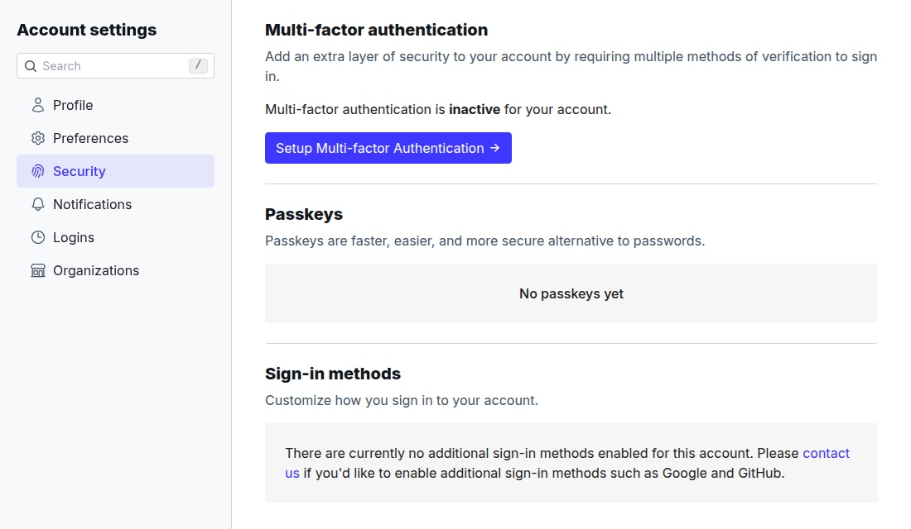

Account settings is where you manage your personal profile, preferences, sign-in security and email notifications. To open it, click your avatar at the top-right corner of the dashboard and then click **Account settings**.

## Finding a setting {#finding-a-setting}

The **Account settings** sidebar lists the sections: **Profile**, **Preferences**, **Security**, **Notifications**, **Logins** and **Organizations**. Click a section to open it. Account settings opens on **Profile**.

To find a setting without knowing its section, type in the **Search** box at the top of the sidebar. Search matches setting names and common terms for them: for example, `2fa` finds **Multi-factor authentication**, and `timezone` finds **Time display**. Click a result, or select it with the arrow keys and press `Enter`, to open its section at that setting. Press `/` to jump to the search box, and `Esc` to clear it.

Account settings search finds only your account's settings. To find an organization's settings, use the search in [organization settings](./organization-settings#finding-a-setting).

## Profile {#profile}

Under **Your details**, change your name and mobile phone number. To change your account email address, contact us through the link under **Email address**. To change your avatar, use [Gravatar](https://gravatar.com/).

## Preferences {#preferences}

Under **Time display**, choose how the dashboard shows dates and times. Turn on **Use relative times** to show them relative to now, and pick a **Time format**: **System**, **12-hour** or **24-hour**.

## Security {#security}

The **Security** section holds your password, multi-factor authentication, passkeys and sign-in methods.

:::info
If your account was provisioned by a partner (Heroku, DigitalOcean or Addons.io), **Security** shows only a link to the partner's dashboard, where you manage your sign-in instead.
:::

### Password {#password}

In **Account settings**, open **Security** and click **Change password** to change your password. You will be requested to enter your current password as well. Your new password needs to be at least 10 characters including a number, a lowercase and an uppercase letter.

If you are logged in but don't remember your current password, you can initiate the "forgot password" protocol by clicking **Reset your password by email**. After clicking it, find the **Reset your SFTP To Go password** email in your inbox and follow the instructions there in order to reset your password.

**Password** appears only if you sign in with a password.

### Multi-factor authentication

Multi-factor authentication (or MFA for short) is used to verify that the identity of a user is genuine. It requires a user to present two or more pieces of evidence (or factors) for authentication. In SFTP To Go, in addition to your email and password authentication, you can secure your account using an authenticator app (such as Google Authenticator, Authy, 1Password and many others).

To enable multi-factor authentication, open **Security** in **Account settings**, click **Setup Multi-factor Authentication** and follow the on-screen instructions.

To turn it off, click **Disable Multi-factor Authentication** in the same place.

:::info
Owners of your organizations can see whether you have enabled or disabled MFA, and can reset it if you lose access to the method you use. You are notified by email whenever this happens. Read more about [resetting a team member's multi-factor authentication](./organization-settings#resetting-a-team-members-multi-factor-authentication).
:::

### Passkeys {#passkeys}

**Passkeys** lists the passkeys you can sign in with instead of a password.

### Sign-in methods {#sign-in-methods}

**Sign-in methods** lists the other ways you can sign in to your account, such as Google or GitHub, when they are enabled for your account.

## Notifications {#notifications}

Under **Email**, choose which activity notifications you receive by email: **Security notifications**, **Developer notifications** and **Billing notifications**.

## Logins {#history}

The **Logins** section lists your most recent login activity, with the location, client, IP address and time of each login.

## Organizations {#organizations}

The **Organizations** section lists the organizations that you are a member of.

Click **New organization** to create a new organization, if you'd like to have organizations with separate entities, billing details, administrators, regions or plans.
