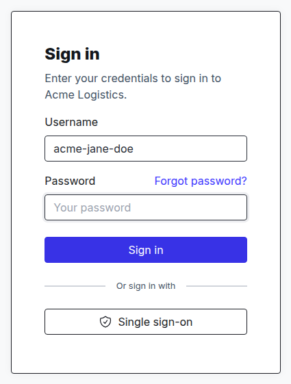
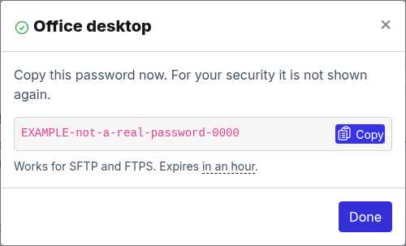
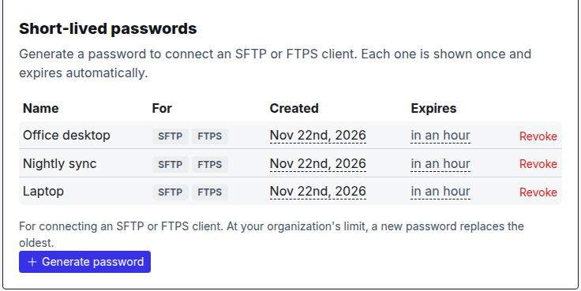

The web portal enables users with SFTP To Go credentials to manage files in their designated storage (i.e., their home directory) using a web browser over a secure HTTPS channel.

To access the web portal, first ensure it is enabled in your organization's [settings tab](../getting-started/organization-settings#web-portal).
Then, log in using your organization's portal login link, which can be found in the settings tab:

1. Enter a credentials username and click **Continue**.
2. Enter a credentials password, or click **Email magic code** if the credentials are associated with an email address and the [Magic Code](../getting-started/organization-settings#authentication-methods) authentication method is enabled. If your organization uses SSO for credentials, click **Single sign-on** instead (refer to [Signing in with SSO](#signing-in-with-sso)).
3. If MFA is enabled, use an extra factor in the authentication process.

:::note
Alternatively, use a shortcut from your SFTP To Go dashboard to connect as any user on your credentials list. Click the menu button (...) and select "Open web portal".
:::

:::note
Credentials associated with email addresses can reset their passwords without contacting an administrator by initiating the "Forgot password" flow, unless your organization allows only SSO sign-in.
:::

## Signing in with SSO

If your organization uses [single sign-on (SSO) for credentials](../security/sso-for-credentials.md), you sign in to the web portal with your organization's identity provider.

### The first time: your SSO link

Your administrator sends you a one-time SSO link for your credentials.

1. Open the link. Your browser goes to your identity provider.
2. Sign in with your identity provider. Your identity is now linked to the credentials, and the web portal opens, signed in.

The link works once and expires 24 hours after your administrator generated it. If it has expired or was already used, the page says so: ask your administrator for a new link.

If your administrator set the link for a specific email address, sign in to your identity provider with that address. If you sign in with a different address, the page says "This SSO link is for a different account at your identity provider."

### Every time after that

1. Open your organization's portal login link, enter your username and click **Continue**.
2. Under **Or sign in with** (or **Sign in with**, if your organization doesn't allow passwords), click **Single sign-on**.

   
3. Sign in with your identity provider. The web portal opens, signed in.

If your organization's web portal uses a [custom domain](../how-to-customize-my-service/custom-web-portal.md), your browser passes through SFTP To Go's default web portal address on the way to your identity provider, and returns to your custom domain.

If the page says "This identity is not linked to any credentials. Ask an administrator to set up SSO for your credentials.", you signed in with an identity that isn't linked yet. Use the SSO link your administrator sent you, or ask for one.

## Short-lived passwords

SFTP and FTPS clients can't sign in with SSO. When you sign in to the web portal with SSO, generate a short-lived password there and use it in your SFTP or FTPS client, with your username. A short-lived password doesn't work for signing in to the web portal.

1. In the web portal, click your avatar at the top-right corner of the screen and click **Settings**.
2. In **Security**, under **Short-lived passwords**, click **Generate password**.
3. Optional: In **Name (optional)**, enter a name that tells you where you use it, such as *Laptop*.
4. Click **Generate**.
5. Click **Copy** and paste the password into your SFTP or FTPS client. The password is shown once: "Copy this password now. For your security it is not shown again." Then click **Done**.

   

Your short-lived passwords are listed under **Short-lived passwords**, with their name, the protocols they work for, when they were created and when they expire.

Your organization sets how long they last and how many you can have active at once. When you are at the limit, a new password replaces your oldest one.

To stop a password before it expires, click **Revoke** next to it, then **Revoke**. Any client using that password stops connecting.

When a password expires, sign in to the web portal with SSO and generate a new one. **Short-lived passwords** appears only when you sign in with SSO.

## Organizing files and folders

### Navigation

The web portal offers various tools for easy and intuitive navigation. The navigation bar, also known as breadcrumbs, displays your current location in the folder hierarchy and enables quick navigation to higher levels. Clicking on a folder will open it, allowing you to view its contents. Remember, each user has a designated home directory, which appears as the root directory in their navigation and is marked by the home icon.

### Creating folders and uploading files

To create a new folder, select the "+" button beside the current folder, then choose "New folder". Name the new folder.

To upload files or folders, select the "+" button beside the current folder and choose "Upload files". Drag and drop files or folders into the designated area, or select "browse files" to open a file browser and choose files for upload. The portal supports uploading a maximum of 1,000 files at once.

### The items list

The item list displays files and folders in the current directory, providing details like file name, modification date, file type, and size for files, and folder name and creation date for folders. For lengthy lists, the web portal paginates, showing 100 items per page.

Each item includes a menu button (...) for actions such as:

* Download file
* Open file in browser
* Print file
* Rename file
* Duplicate file (create a copy within same folder)
* Copy or move file to another folder
* Copy file path to clipboard.

**Print** is available for files the browser can display: PDFs, images, plain text and code, CSV and TSV spreadsheets, and Markdown. When previewing one of these files you can also press `Cmd`+`P` (or `Ctrl`+`P`) to print it. Some browsers cannot print PDFs directly — in that case the file opens in a new tab so you can print it from there.

### Bulk operations

Selecting all or some files/folders in the items list displays the count of selected items above the list, along with a menu button (...). This allows bulk operations on the selected items:

* Copy selected files to another folder
* Move selected files to another folder
* Delete selected items

## User Settings

Click the avatar at the top-right corner of the screen in order to change user settings such as Multi-factor authentication.

## Limitations

File and folder names can include any Unicode character. However, for compatibility with SFTP and S3 clients, they must not contain the following characters:

* 'Pound' character ("#")
* Percent character ("%")
* Caret ("^")
* Asterisk ("\*")
* Left square bracket ("`[`")
* Right square bracket ("`]`")
* Left curly brace ("`{`")
* Right curly brace ("`}`")
* Grave accent / back tick ("`")
* Quotation marks (",')
* 'Greater Than' symbol ("`>`")
* 'Less Than' symbol ("`<`")
* Forward slash ("/")

Additionally, avoid using file or folder names longer than 255 characters.

:::note
File upload through the web portal does not support resuming interrupted uploads.
:::