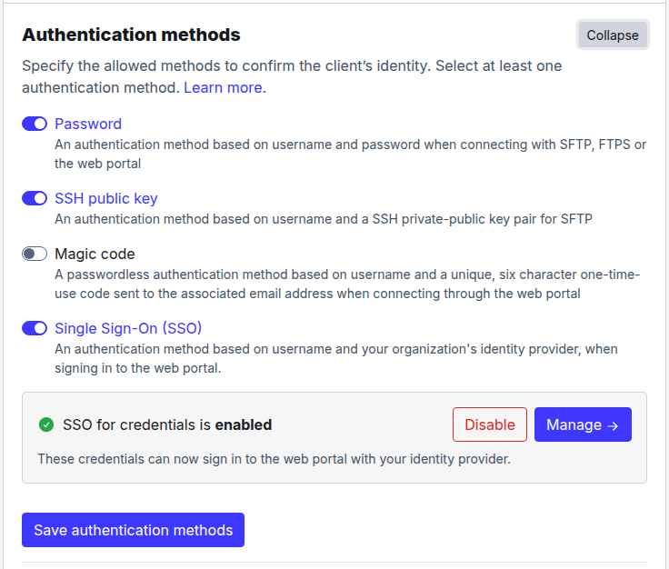
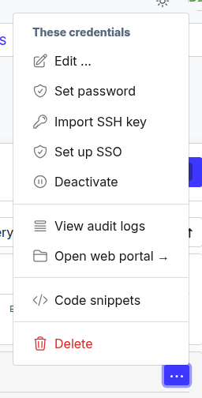
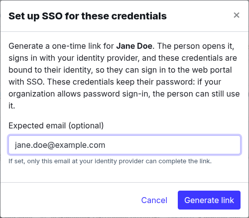
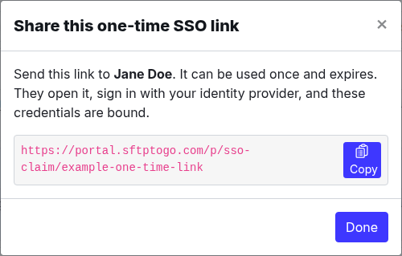
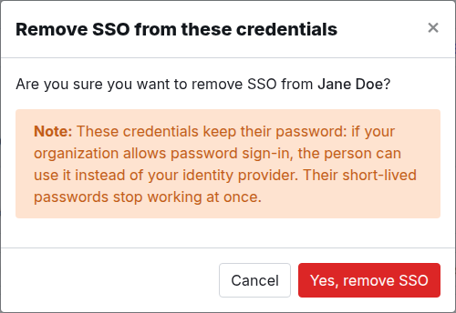
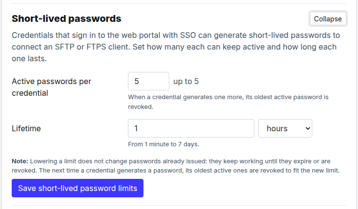
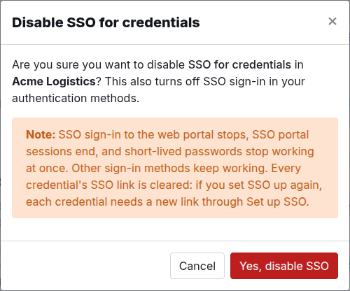

Single sign-on (SSO) for credentials lets the people who use your SFTP To Go credentials sign in to the [web portal](../how-to-connect/connect-web-portal.md) with your organization's identity provider. From the web portal, they generate short-lived passwords to connect SFTP and FTPS clients.

SSO for credentials is for the people who transfer files: the web portal and SFTP and FTPS clients. It is separate from [team SSO](../getting-started/organization-settings.md#sso), which controls how your team members sign in to the SFTP To Go dashboard. You can use either one, or both.

:::info
SSO for credentials is only available with certain plans. Read more about our different plans [here](https://sftptogo.com/pricing)
:::

## Before you start

- Only an organization owner can set up SSO for credentials, link credentials and turn SSO off.
- SSO for credentials is available to organizations that subscribe to SFTP To Go directly. It isn't available to organizations subscribed through a marketplace add-on, such as the Heroku add-on.
- On a plan without SSO for credentials, the **Single Sign-On (SSO)** authentication method is shown turned off and locked, with an upgrade prompt.
- The identity provider connection for credentials is separate from the one [team SSO](../getting-started/organization-settings.md#sso) uses. You set it up on its own, even if you already use team SSO.

:::note
Each set of credentials links to one identity at your identity provider, and an identity links to one set of credentials. If a person uses several sets of credentials, they need a different identity at your identity provider for each set.
:::

## How it works

1. You connect your identity provider to SFTP To Go and turn on the **Single Sign-On (SSO)** authentication method.
2. For each set of credentials a person uses, you generate a one-time link and send it to them.
3. The person opens the link and signs in with your identity provider. Their identity is now linked to those credentials.
4. From then on, they sign in to the web portal with **Single sign-on**. To connect an SFTP or FTPS client, they generate a short-lived password in the web portal.

Your organization's default credentials can't be linked. They are the only credentials with [Amazon S3 access keys](../how-to-connect/connect-using-amazon-s3.md), so SSO doesn't change S3 access.

## Setting up SSO for credentials {#setting-up}

1. Open your organization's **Settings** tab and go to **Security**. In **Authentication methods**, click **Expand**.
2. Turn on **Single Sign-On (SSO)**. A status panel appears under it: "SSO for credentials is **not configured**".
3. Click **Set up**. The identity provider setup wizard opens in a new browser tab. Follow its steps to connect your identity provider.
4. When the wizard is done, return to the settings. The status panel shows "SSO for credentials is **enabled**". If it still shows **in progress**, reload the page.

   
5. Click **Save authentication methods**.

The status panel shows where the setup stands:

| Status | Meaning | Buttons |
| --- | --- | --- |
| SSO for credentials is **not configured** | No identity provider is connected yet. | **Set up** |
| SSO for credentials setup **in progress** | The wizard was started but not finished. | **Continue setup**, **Disable** |
| SSO for credentials is **enabled** | Your identity provider is connected. | **Manage**, **Disable** |

SFTP To Go refuses to save **Single Sign-On (SSO)** as an authentication method until the wizard is finished, with the message "Finish setting up SSO for credentials before turning on SSO sign-in." Finish the wizard, then save again.

To change the connection later, click **Manage** to open the wizard again.

## Linking credentials {#linking-credentials}

To let a person sign in with SSO, generate a one-time link for their credentials and send it to them.

1. Open your organization's **Credentials** tab.
2. On the credentials row, open the **...** menu and select **Set up SSO**. The menu shows **Set up SSO** after **Single Sign-On (SSO)** is saved as an authentication method.

   

3. Optional: In **Expected email (optional)**, enter the person's email address at your identity provider. Only that identity can then use the link.

   

4. Click **Generate link**.
5. In **Share this one-time SSO link**, click **Copy** and send the link to the person. Then click **Done**.

   

The link:

- works once, and expires 24 hours after you generate it;
- opens on SFTP To Go's default web portal address, even if your web portal uses a [custom domain](../how-to-customize-my-service/custom-web-portal.md);
- links the credentials to the identity the person signs in with, so send it only to the person who uses these credentials.

The person opens the link and signs in with your identity provider. The web portal then opens, signed in as those credentials. If the credentials are deactivated or expired, the link can't be used: the person sees "These credentials are not active." and the link stays unused. [Signing in with SSO](../how-to-connect/connect-web-portal.md#signing-in-with-sso) describes what they see.

Until the person uses the link, the credentials show **Single Sign-On (SSO), link not claimed** under **Authentication methods** in their details. After that, they show **Single Sign-On (SSO)**.

To send a new link, select **Set up SSO** again. The new link replaces the earlier one, which stops working. If the earlier link had an expected email, enter it again.

To link the credentials to someone else after the link was used, remove SSO from them first, then set up SSO again.

### Removing SSO from credentials {#removing-sso}

1. Open your organization's **Credentials** tab.
2. On the credentials row, open the **...** menu and select **Remove SSO**.
3. Click **Yes, remove SSO**.

   

After you remove SSO:

- the person's identity no longer signs in to these credentials;
- the credentials keep their own password. If your organization allows **Password** sign-in, it still works;
- the credentials' short-lived passwords stop working at once;
- a web portal tab the person has open ends at its next action, on a page that says the session has expired.

If the link wasn't used yet, removing SSO makes it stop working, and the password is unchanged.

## Short-lived passwords {#short-lived-passwords}

SFTP and FTPS clients can't sign in with SSO. Instead, a person signed in to the web portal with SSO generates a short-lived password and uses it, with the credentials' username, in their SFTP or FTPS client. [Generating a short-lived password](../how-to-connect/connect-web-portal.md#short-lived-passwords) walks through it.

A short-lived password:

- works over SFTP and FTPS only, never to sign in to the web portal;
- is shown once, when it is generated;
- can no longer be used to connect when it expires, when the person revokes it, or when a new one replaces it at your [limit](#short-lived-password-limits). It also stops when you [remove SSO from the credentials](#removing-sso) or [turn SSO off](#turning-sso-off);
- works even when the **Password** authentication method is turned off.

Only a web portal session signed in with SSO can generate short-lived passwords. A session signed in with a password or a magic code doesn't show them.

### Setting the limits {#short-lived-password-limits}

1. Open your organization's **Settings** tab and go to **Security**. In **Short-lived passwords**, click **Expand**.
2. In **Active passwords per credential**, enter how many short-lived passwords each set of credentials can have active at once, from 1 to 5. The default is 5.
3. In **Lifetime**, enter how long each new password lasts, and choose a unit (days, hours, minutes or seconds). It can be from 1 minute to 7 days. The default is 1 hour.
4. Click **Save short-lived password limits**.

   

When a set of credentials already has as many active passwords as the limit allows, a new password replaces the oldest one, which stops working.

Lowering a limit doesn't change passwords already issued: they keep working until they expire or are revoked. The next time a set of credentials generates a password, its oldest active ones are revoked to fit the new limit.

## How SSO works with the other sign-in methods {#sign-in-methods}

### Linking adds a way to sign in

Linking credentials doesn't take anything away. Linked credentials keep their own password and SSH keys, and can use every method your organization allows in [Authentication methods](../getting-started/organization-settings.md#authentication-methods). For example, while **Password** is turned on, a linked person can sign in to the web portal with SSO or with the password.

### SSO only {#sso-only}

To make SSO the only way to sign in, turn off every other authentication method and save, leaving only **Single Sign-On (SSO)**. Then:

- **Linked credentials** sign in to the web portal with SSO only. Over SFTP and FTPS, they connect with short-lived passwords. Over SFTP, they can also use SSH keys already added to the credentials (refer to [When someone leaves](#when-someone-leaves)). Their own password doesn't work anywhere, and **Forgot password** in the web portal sends no email.
- **Credentials that aren't linked** can't sign in at all, to the web portal or over SFTP and FTPS. Link them before you turn the other methods off.

:::warning
SSO only also stops credentials that scripts and integrations use, unless they are linked. A linked set of credentials can keep connecting over SFTP with an SSH key, because SSH keys of linked credentials keep working whenever **Password** and **SSH public key** are both turned off and **Single Sign-On (SSO)** is on. The credentials' details show this under their SSH keys.
:::

### Multi-factor authentication

When a person signs in to the web portal with SSO, your identity provider is in charge of multi-factor authentication: set it up there. SFTP To Go doesn't ask for its own one-time code on an SSO sign-in, even when your organization's [multi-factor authentication](../getting-started/organization-settings.md#multi-factor-authentication) settings require it for the web portal.

Over SFTP and FTPS, short-lived passwords and SSH keys aren't asked for a one-time code.

### Inbound network rules

Your organization's and the credentials' [inbound network rules](using-inbound-network-rules.md) apply to SSO sign-in to the web portal, as they do to the other ways of signing in.

## Turning SSO off {#turning-sso-off}

There are two ways to turn SSO off.

**Disable SSO for credentials** disconnects your identity provider:

1. Open your organization's **Settings** tab and go to **Security**. In **Authentication methods**, click **Expand**.
2. In the SSO status panel, click **Disable**.
3. Click **Yes, disable SSO**.

   

Disabling SSO for credentials:

- turns off **Single Sign-On (SSO)** in your authentication methods;
- ends every web portal session signed in with SSO at once;
- revokes every short-lived password at once;
- removes the SSO link from every set of credentials, including links not used yet.

Other sign-in methods keep working, and credentials keep their own passwords. If you set SSO up again later, each set of credentials needs a new link through **Set up SSO**.

You can't disable SSO for credentials while it is your organization's only sign-in method, because nobody could sign in afterwards. Turn on another authentication method and save it first.

**Turning off the Single Sign-On (SSO) method** keeps your identity provider connected and the credentials linked. Turn off **Single Sign-On (SSO)** in **Authentication methods** and click **Save authentication methods**. SSO sign-in to the web portal stops, open SSO sessions end at their next action, and every short-lived password is revoked at once. When you turn the method on again, linked credentials sign in with SSO again, without new links.

## When someone leaves {#when-someone-leaves}

When a person who uses linked credentials leaves, disable or delete them at your identity provider, then [remove SSO from their credentials](#removing-sso). Disabling the person at your identity provider stops new SSO sign-ins only: their short-lived passwords, and a web portal tab they have open, keep working until you remove SSO from the credentials. Removing SSO revokes their short-lived passwords at once.

If nobody else uses the credentials, you can deactivate them instead: on the credentials row, open the **...** menu and select **Deactivate**. Deactivated credentials can't sign in to the web portal or connect over SFTP and FTPS. They stay linked to the person's identity, so if you might reactivate them later, remove SSO from them first.

If the credentials stay active, also check these:

- **Their password.** Linked credentials keep their own password. If **Password** sign-in is turned on, give the credentials a new password, so the person can't sign in with the old one: on the credentials row, open the **...** menu and select **Set password**.
- **SSH keys.** Delete the SSH keys the person added to the credentials. If **SSH public key** sign-in is turned on, they keep working over SFTP after you remove SSO. Under [SSO only](#sso-only), they keep working until you remove SSO from the credentials or delete the key. Disabling the person at your identity provider doesn't stop a key.

Either way, check **share links**. Share links the person created keep working: turning SSO off and removing SSO from the credentials don't end them. Delete them from your organization's **Share links** tab. Refer to [Sharing files and folders](../getting-started/sharing-files-and-folders.md).

## Audit log events {#audit-log-events}

SSO for credentials adds these events to your [audit logs](audit-logs.md#event-types):

| Event | Recorded when |
| --- | --- |
| `user.login` with `Method` `sso` | A person signs in to the web portal with SSO. |
| `credentials-sso.setup` | An owner starts or updates the identity provider setup. |
| `credentials-sso.disabled` | An owner disables SSO for credentials. |
| `user.sso.added` | An owner generates a link with **Set up SSO**. The link itself is never recorded. |
| `user.sso.removed` | An owner removes SSO from credentials. |
| `user.issued-password-created` | A person generates a short-lived password. |
| `user.issued-password-revoked` | A person revokes a short-lived password, or a new one replaces the oldest at your limit. |

Short-lived passwords that end because you remove SSO from credentials, delete credentials or turn SSO off aren't recorded one by one: the owner's action is the event. `user.sso.removed` lists the short-lived passwords it ended, and `credentials-sso.disabled` counts the credentials unlinked and the short-lived passwords ended. Passwords that expire aren't recorded either: each one's expiry is in its `user.issued-password-created` event.

The password itself is never recorded.
